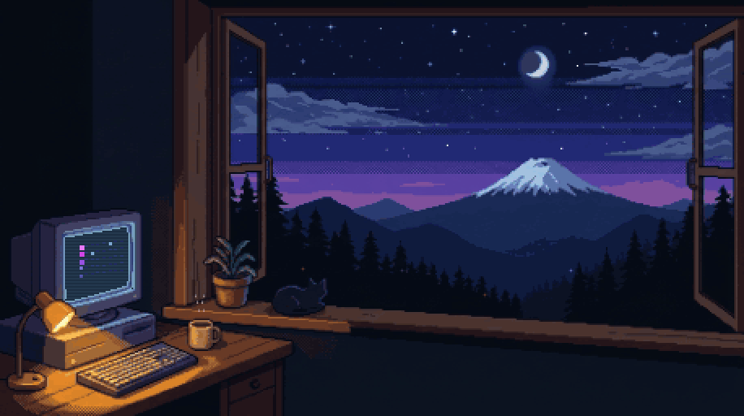

  

    

  <h1>Cristian Acalo</h1>

  

    Middle Full Stack en <strong>Evaluar</strong> · Latacunga, EC
     
    <a href="https://cristianacalo.netlify.app">Portafolio</a> ·
    <a href="https://www.linkedin.com/in/cristianacalo">LinkedIn</a> ·
    <a href="mailto:cristianchoacalo@gmail.com">cristianchoacalo@gmail.com</a>
  

---

Trabajo con **Go**, **Nuxt** y serverless en **AWS** y **Cloudflare**. Antes estuve en core bancario, sistemas financieros y automatización de CRM sobre WhatsApp.

Fuera de horario armo herramientas y experimentos propios: agentes de código, trading, síntesis de audio y pipelines de video.

## Proyectos

| Proyecto | Descripción | Stack |
| :--- | :--- | :--- |
| [**relevo**](https://github.com/CrisAcalo/relevo) | CLI para delegar y auditar agentes en `git worktree` aislados | `Node.js` · `0 deps` |
| [**CrisV2**](https://github.com/CrisAcalo/CrisV2) | Segunda versión de mi portafolio | `Next.js` · `Prisma` |
| [**BlogCris**](https://github.com/CrisAcalo/Nuxt_Practice) | Blog con rutas de servidor y pruebas E2E | `Nuxt 4` · `Playwright` |
| [**FrutiAventura**](https://github.com/CrisAcalo/FrutiAventura) | SPA comercial con pruebas unitarias | `Vue 3` · `Vitest` |

**En laboratorio** *(privados)*
- **Procedural // Studio** — Síntesis de audio y visuales 3D con osciladores puros (`Svelte 5`, `Web Audio`, `Canvas`).
- **QuantTrading** — Bot cuantitativo 24/7 con auditoría multi-LLM (`FastAPI`, `Asyncio`, `CCXT`, `React 19`).
- **ViralRadar + ViralCraft** — Radar en `Go` conectado a un pipeline de video (`Edge-TTS`, `Whisper CUDA`, `Remotion`, `FFmpeg NVENC`).
- **Mori** — App para parejas con widgets nativos y pixel art (`Kotlin Multiplatform`, `Jetpack Glance`, `R2`, `Supabase`).

## Stack

  
   
  

## Actividad

  <picture>
    <source media="(prefers-color-scheme: dark)" srcset="https://raw.githubusercontent.com/CrisAcalo/CrisAcalo/output/github-snake-dark.svg" />
    <source media="(prefers-color-scheme: light)" srcset="https://raw.githubusercontent.com/CrisAcalo/CrisAcalo/output/github-snake.svg" />
    
  </picture>

 

  
  

