  

    

  <a href="https://cristianacalo.netlify.app">Portafolio</a> ·
  <a href="https://www.linkedin.com/in/cristianacalo">LinkedIn</a> ·
  <a href="mailto:cristianchoacalo@gmail.com">cristianchoacalo@gmail.com</a>

---

Soy Cristian. Trabajo como Middle Full Stack en **Evaluar** con Go, Nuxt y serverless en AWS y Cloudflare. Antes pasé por core bancario, sistemas financieros y automatización de CRM sobre WhatsApp.

Fuera de horario armo herramientas para automatizar cosas o explorar lo que me da curiosidad: agentes, trading, audio procedural y pipelines de video.

  

## Qué estoy construyendo

**Públicos**
- [**relevo**](https://github.com/CrisAcalo/relevo) — Orquestador de agentes en Node.js sin dependencias; cada agente corre en su `git worktree` y quien programa nunca audita.
- [**CrisV2**](https://github.com/CrisAcalo/CrisV2) — Segunda versión de mi portafolio en Next.js y Prisma.
- [**BlogCris**](https://github.com/CrisAcalo/Nuxt_Practice) · [**FrutiAventura**](https://github.com/CrisAcalo/FrutiAventura) — Experimentos en Nuxt 4 / Vue 3 con Playwright y Vitest.

**En laboratorio** *(privados / locales)*
- **Procedural // Studio** — Síntesis de audio y visuales 3D en `Svelte 5`, `Web Audio` y `Canvas`. Puros osciladores, sin IA.
- **QuantTrading** — Plataforma cuantitativa 24/7 (`FastAPI + Asyncio + CCXT` y `React 19`) con auditoría de riesgo en cascada.
- **ViralRadar + ViralCraft** — Radar en `Go` conectado a un pipeline de video (`Edge-TTS`, `Whisper CUDA`, `Remotion`, `FFmpeg NVENC`).
- **Mori** — App para parejas en `Kotlin Multiplatform` con widgets (`Jetpack Glance`), pixel art en `R2` y tiempo real en `Supabase`.

## Stack

  
   
  

## Actividad

  <picture>
    <source media="(prefers-color-scheme: dark)" srcset="https://raw.githubusercontent.com/CrisAcalo/CrisAcalo/output/github-snake-dark.svg" />
    <source media="(prefers-color-scheme: light)" srcset="https://raw.githubusercontent.com/CrisAcalo/CrisAcalo/output/github-snake.svg" />
    
  </picture>

 

  
  

 

  

