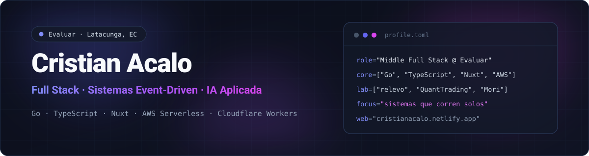
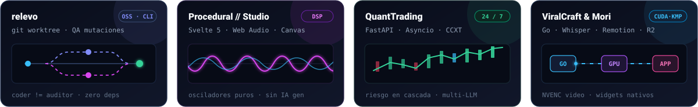

  

    

  <a href="https://cristianacalo.netlify.app">Portafolio</a> ·
  <a href="https://www.linkedin.com/in/cristianacalo">LinkedIn</a> ·
  <a href="mailto:cristianchoacalo@gmail.com">cristianchoacalo@gmail.com</a>

 

  

Soy Cristian. Trabajo como Middle Full Stack en **Evaluar** con Go, Nuxt y arquitectura serverless en AWS y Cloudflare. Antes pasé por core bancario, sistemas financieros y automatización de CRM con agentes sobre WhatsApp.

Fuera de horario construyo herramientas para resolver problemas de manera automatizada o explorar cosas que me dan curiosidad: orquestadores de agentes, motores de trading, síntesis de audio y pipelines de video.

 

  

 

  

## Qué estoy construyendo

  

 

**Públicos**
- [**relevo**](https://github.com/CrisAcalo/relevo) — Delegación y auditoría de agentes de código sin dependencias en Node.js. Cada agente corre en su propio `git worktree` con permisos acotados por rol y QA con mutaciones: quien escribe el código nunca emite el veredicto.
- [**CrisV2**](https://github.com/CrisAcalo/CrisV2) — Segunda versión de mi portafolio en Next.js y Prisma.
- [**BlogCris**](https://github.com/CrisAcalo/Nuxt_Practice) · [**FrutiAventura**](https://github.com/CrisAcalo/FrutiAventura) — Experimentos web en Nuxt 4 / Vue 3 con Playwright y Vitest.

**En laboratorio** *(repos privados / locales)*
- **Procedural // Studio** — Estudio de composición algorítmica y visualización 3D en `Svelte 5`, `Web Audio` y `Canvas`. Todo suena desde osciladores, filtros y reglas armónicas; sin modelos entrenados ni IA generativa.
- **QuantTrading** — Plataforma cuantitativa 24/7 desacoplada (`FastAPI + Asyncio + CCXT` y frontend en `React 19`) con auditoría de riesgo en cascada sobre varios LLMs.
- **ViralRadar + ViralCraft** — Radar diario en `Go` que evalúa nichos y envía encargos a un pipeline de video con voz neuronal (`Edge-TTS`), alineación por palabra (`Whisper CUDA`), `Remotion` y `FFmpeg NVENC`.
- **Mori** — App para parejas en `Kotlin Multiplatform` con widgets nativos (`Jetpack Glance`), pixel art en `Cloudflare R2` y tiempo real sobre `Supabase`.

  

## Stack

  

    
     
    
  

  

 

  

## Actividad

  <picture>
    <source media="(prefers-color-scheme: dark)" srcset="https://raw.githubusercontent.com/CrisAcalo/CrisAcalo/output/github-snake-dark.svg" />
    <source media="(prefers-color-scheme: light)" srcset="https://raw.githubusercontent.com/CrisAcalo/CrisAcalo/output/github-snake.svg" />
    
  </picture>

 

  
  

 

  

